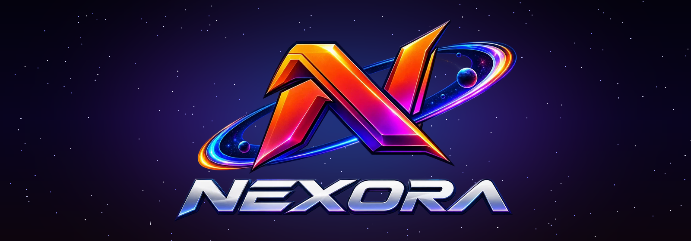

  

<h2 align="center">🤖 NEXORA Redesign — «ORACLE جاااااااااان!» Update</h2>

  

## ✨ مهم‌ترین‌ها

- 🤖 **اوراکل حالا شخصیت داره!** شیطون، بامزه، کمی تیکه‌انداز و گاهی غیرقابل‌پیش‌بینی — با امضای معروفش: **«جاااااااااان!»**
- 👥 **۳۹ بازیکن رو می‌شناسه** — اورجینال، صابر، لودر، کاکرو، پدرو، دنی، مهیار، اسکورپیون، شادو، علی‌گاد، آرش سیبیل و بقیه؛ با غلط تایپی و حروف لاتین هم (مثلاً `orginal` یا `mahyar ro mishnasi`).
- 😂 **خوشامد ورود تصادفی**: «جاااااااااان اورجینال رو بگیر! … اِه! تو که اورجینال نیستی!» — همیشه با اسم واقعی خودت و بدون ادعای دروغ.
- 🏆 **واکنش به برد و باخت واقعی** روی صفحه‌ی نتیجه — از «آفرین قهرمان! ترکوندی!» تا «اوراکل شاهد یک فاجعه تاریخی بود!»
- 🎓 **آموزش‌های خنده‌دار ولی دقیق**: «ضربات یخی فرم بزن!»، «بمیره دلی که بترسد! بزن بره!» — همراه توضیح واقعی کنترل‌ها؛ فقط برای تازه‌کارها، و از دکمه‌ی اوراکل داخل بازی دوباره قابل دیدن.
- 🧭 **تور راهنمای قدم‌به‌قدم**: اولین باری که هر بخش رو باز می‌کنی (خانه، داک، بازی‌ها، لابی هر بازی، اتاق‌ها، تورنمنت، فروشگاه، اجتماعی، چت، پروفایل، تنظیمات) اوراکل با نورافکن روی هر قسمت توضیحش می‌ده. «دیدن دوباره‌ی تور اوراکل» در تنظیمات.
- 💬 **جمله‌های خودجوش** با زمان‌بندی و بدون تکرار؛ وسط بازی مزاحم نمی‌شه.
- 🛠️ **همه‌چیز از پنل مدیر قابل‌ویرایشه**: بازیکن‌ها و نام‌های مستعار، جمله‌ها، خوشامدها، آموزش‌ها، متن تورها، احتمال‌ها و فاصله‌ها — بدون آپدیت اپ.
- 🧠 **هوش آنلاین اوراکل** (nx-oracle) حالا شخصیت و پروفایل‌های تأییدشده‌ی بازیکن‌ها رو می‌شناسه و چیزی از خودش نمی‌سازه.

## 📲 نصب

1. فایل **`NEXORA-redesign-universal.apk`** رو از پایین همین صفحه دانلود کن (برای اکثر گوشی‌ها `arm64-v8a` کوچیک‌تره).
2. اگه اندروید پرسید، «نصب از منابع ناشناس» رو برای مرورگر یا فایل‌منیجر فعال کن.
3. نصب کن و وارد شو. نسخه‌های قبلی redesign رو مستقیم آپدیت می‌کنه (همون کلید امضا).

## 🔄 آپدیت

به‌روزرسان داخل اپ این نسخه و نسخه‌های بعدی `redesign-*` رو خودش پیدا می‌کنه. اپ قبلی NEXORA (React Native) دست‌نخورده می‌مونه.

---

## ✨ Highlights (English)

- 🤖 **ORACLE has a personality** — cute, funny, playful, a little sarcastic, with the stretched signature **"جاااااااااان!"**.
- 👥 **Recognises 39 players** by name, with typos, ZWNJ/Arabic-letter variants and Latin spellings — personalised lines preserved verbatim.
- 😂 **Random login greetings** (the "is that Original?" mix-up joke) using your real display name, sometimes silent.
- 🏆 **Win/lose reactions** from real match results (offline and online).
- 🎓 **Funny but accurate tutorials** per game mechanic, shown to newcomers only, replayable from the in-game ORACLE sheet.
- 🧭 **First-run guided tour** with spotlight coach marks for every section; once per section per account (device + cloud profile); replay from Settings.
- 💬 **Spontaneous lines** with cooldowns and no repeats; never during key gameplay.
- 🛠️ **Admin-editable config** in Supabase (`nx_oracle_persona`, owner / `oracle` permission, audited).
- 🧠 **nx-oracle AI** gets the persona rules and verified player profiles as context.

### 📲 Install
Download **`NEXORA-redesign-universal.apk`** below (or `arm64-v8a` for most phones), allow installs from unknown sources, install. Updates previous redesign builds in place (same signing key).

### 🔄 Updates
The in-app updater picks up `redesign-*` releases (prerelease or not). This release is **not** marked "latest", so the React Native app's updater is unaffected.
